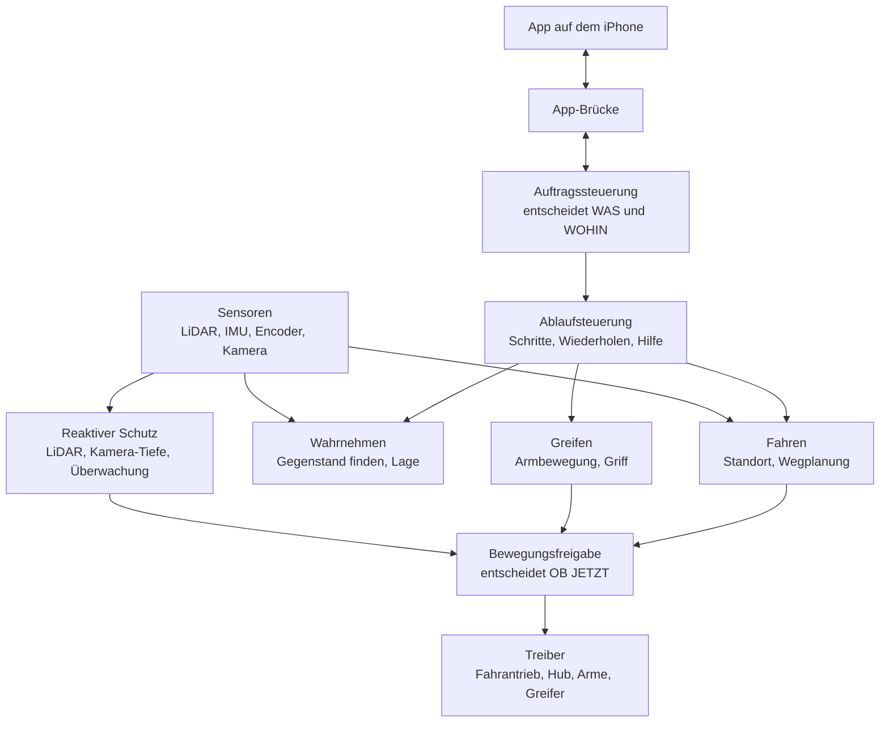

# Softwarekonzept HomeMy

Status: Entwurf zur Abstimmung mit dem Projektinhaber. Die Grundsatzfragen sind entschieden (Abschnitt 10). Programmiert und in der Simulation getestet sind die Stufen S1 (Roboterseite der App) und S2 (Fahren in der Simulation).
Stand: 17.11.2026.

Dieses Dokument ist bewusst auf Deutsch geschrieben, weil es die Referenz für den Projektinhaber ist. Die Verträge unter `contracts/` bleiben englisch und legen später jede Schnittstelle im Detail fest. Das Konzept gibt die Richtung vor, die Verträge die Regeln.

## 1. Zielbild

Nachdem ein Mensch die Wohnung einmal kartiert hat, fährt HomeMy auf Befehl aus der App in Räume, greift Gegenstände und bringt sie an einen anderen Ort.

Die App kennt dafür drei Befehle:

| Befehl | Bedeutung |
| --- | --- |
| Fahre zu … | einen Raum oder einen eingelernten Ort anfahren |
| Hole … von … nach … | einen Gegenstand an einem Ort greifen und an einem anderen abstellen |
| Stopp, Weiter, Abbrechen | jederzeit anhalten, fortsetzen oder beenden |

Das Ziel wird in vier Ausbaustufen erreicht. Jede Stufe ist für sich nutzbar und Voraussetzung für die nächste.

| Stufe | HomeMy kann | Neu gegenüber der Stufe davor |
| --- | --- | --- |
| V1 Fahren | Räume und Orte anfahren | Lokalisierung, Navigation, Aufträge aus der App |
| V2 Holen am bekannten Ort | einen bekannten Gegenstand an einem eingelernten Ort greifen und an einem eingelernten Ort abstellen, mit einem Arm | Objekterkennung, Armsteuerung, Greifer |
| V3a Standplatz entlang einer Kante | sich an einer eingelernten Tischkante selbst vor den Gegenstand stellen | Wahl des Standplatzes in einer Richtung |
| V3b Suchen im Raum | einen Gegenstand irgendwo im Raum finden und sich selbst davor stellen | freie Wahl des Standplatzes, Erkennen von Tischkanten |
| V4 Erweitert | zwei Arme, Übergabe an eine Person, neue Gegenstände per Beschreibung | Koordination beider Arme, offene Erkennung |

Dieses Konzept beschreibt V1 und V2 genau und V3 und V4 nur so weit, dass der Weg dorthin nicht verbaut wird.

## 2. Leitsätze

Die Leitsätze stammen aus den Erfahrungen mit Amadeus und aus den Regeln dieses Repos.

1. **Nur Not-Halt und Hardwarefehler verriegeln den Roboter.** In allen anderen Fällen bringt eine starke Selbstheilung ihn von selbst in den normalen Betrieb zurück. Das hast du am 17.11.2026 für HomeMy entschieden; es schärft deinen Amadeus-Leitsatz vom 15.10.2026. Anhalten ist sicher, Abbrechen ist teuer.
2. **Fehlende oder alte Sensordaten erlauben nie eine Bewegung, beenden aber auch keinen Auftrag.** Der Roboter wartet, bis die Daten wieder da sind.
3. **Erkennung, KI und App erteilen keine Bewegungsfreigabe.** Ein erkannter Gegenstand ist ein Vorschlag. Ob sich etwas bewegen darf, entscheidet allein die Bewegungsfreigabe auf dem Roboter.
4. **Entweder fahren oder greifen.** Bis einschließlich V3 bewegen sich Fahrwerk und Arme nie gleichzeitig. Gefahren wird nur mit den Armen in Fahrhaltung, gegriffen nur im nachgewiesenen Stillstand.
5. **Greifen rechnet vom Roboter aus, nicht von der Karte aus.** Die Lage eines Gegenstands wird relativ zum Roboter bestimmt. Die Karte dient nur dem Hinfahren. Das war bei Amadeus eine feste Regel, weil Kartenfehler sonst direkt zu Fehlgriffen führen.
6. **Einlernen statt selbst herausfinden, wo es geht.** Orte werden mit dem Controller angefahren und gespeichert, so wie die Karte auch von Hand gefahren wird.
7. **Wenige gemessene Prüfungen statt vieler ungemessener.** Bei Amadeus gab es am Ende 76 verschiedene Abbruchgründe, und reale Läufe scheiterten an Zeitgrenzen, die nie gegen die Hardware gemessen waren. Jede Sperre in HomeMy braucht eine gemessene Reserve und einen festgelegten Weg, wie es danach weitergeht.
8. **Erst Simulation mit dem echten Programmcode, dann ohne Motoren, dann beaufsichtigt am Roboter.**
9. **Jedes Gerät hat genau einen Besitzer.** Ein Erfolg gegen eine Attrappe wird nie als echter Erfolg gemeldet.
10. **Vom Einfachen zum Schwierigen.** Jede Stufe muss am Roboter funktionieren, bevor die nächste beginnt. Bei Amadeus wurde gleich mit dem Schwierigsten begonnen, und das Projekt hat sich darin verloren. Das hast du am 17.11.2026 als Grundsatz festgelegt.

Leitsatz 1 ist als eigene Entscheidung festgehalten: `docs/decisions/2026-11-17-self-healing-and-latching.md`. Die Verträge, die vorher das Gegenteil sagten, sind angepasst.

## 3. Der Hol-Auftrag Schritt für Schritt

Der Ablauf gilt für V2. Er ist die Messlatte für alle Bausteine.

### Einmalige Vorbereitung

1. Wohnung mit dem Controller abfahren, Karte speichern, Räume einzeichnen. Das kann die App heute schon.
2. Orte einlernen: Den Roboter mit dem Controller so vor einen Tisch oder ein Regal stellen, wie er später zum Greifen stehen soll. In der App „Ort hier speichern“ wählen und einen Namen vergeben, zum Beispiel „Küchentisch“.

Ein Ort speichert die Stellung des Roboters auf der Karte, die Art (Greifort, Ablageort, Parkplatz) und die Höhe der Fläche.

### Ablauf eines Auftrags

| Nr. | Schritt | Was geschieht | Wenn es nicht klappt |
| --- | --- | --- | --- |
| 1 | Auftrag | In der App Gegenstand, Greifort und Ablageort wählen | – |
| 2 | Annahme | Roboter prüft: bereit, Standort bekannt, Akku ausreichend, Arm in Fahrhaltung, Erkennung erreichbar | Ablehnung mit Grund in der App |
| 3 | Hinfahren | Fahrt zum Greifort, Arme in Fahrhaltung gesperrt | warten, neu planen |
| 4 | Ausrichten | Stellung am Ort gegen die eingelernte Stellung prüfen und nachsetzen | erneut anfahren |
| 5 | Umschalten | Stillstand nachweisen, Fahrwerk sperren, Arm freigeben, Hub auf Arbeitshöhe | warten |
| 6 | Finden | Die OAK oben am Roboter sucht den Gegenstand und bestimmt seine Lage grob, relativ zum Roboter | erneut hinsehen, sonst „nicht gefunden“ |
| 7 | Fein orten | Der Arm bringt die Kamera am Handgelenk vor den Gegenstand; sie bestimmt die Lage genau | Blickwinkel ändern |
| 8 | Planen | Griff und Armbewegung berechnen und prüfen: erreichbar, kollisionsfrei, innerhalb der Grenzen | anderen Griff versuchen |
| 9 | Greifen | in Schritten annähern („sehen, bewegen, wieder sehen“), schließen, anheben, Griff prüfen | lösen und neu versuchen, höchstens dreimal |
| 10 | Tragen | Arm in Tragehaltung, Hub auf Fahrhöhe, Fahrwerk freigeben | – |
| 11 | Bringen | Fahrt zum Ablageort mit vergrößertem Fahrumriss | warten, neu planen |
| 12 | Abstellen | Fläche frei? Absetzen, öffnen, zurückziehen | andere Stelle auf der Fläche |
| 13 | Abschluss | Arm in Fahrhaltung, Ergebnis an die App | – |

### Wenn etwas schiefgeht

Jeder Fehler durchläuft dieselbe begrenzte Leiter. Sie ist von der Heilungsleiter aus dem Amadeus-Konzept abgeleitet.

| Stufe | Maßnahme | Grenze |
| --- | --- | --- |
| H0 Warten | stillstehen, bis Daten oder Weg wieder frei sind | einige Sekunden |
| H1 Wiederholen | denselben Schritt mit frischen Daten neu rechnen | zweimal je Schritt |
| H2 Anders versuchen | anderer Weg, anderer Blick, anderer Griff | dreimal je Schritt |
| H3 Sicher beenden | den Auftrag mit einer klaren Meldung beenden; der Roboter ist danach von selbst wieder bereit | einmal |
| H4 Hilfe | Meldung in der App mit Grund und Vorschlag, „Weiter“ möglich; das ist eine Auskunft und keine Sperre | – |

Zwei feste Regeln:

- **Ein Gegenstand in der Hand wird nie fallen gelassen.** Scheitert der Auftrag nach dem Greifen, bleibt der Roboter stehen und bittet um Hilfe, oder er stellt den Gegenstand am nächsten erreichbaren Ablageort ab.
- **Verriegelt wird nur bei Not-Halt und Hardwarefehler.** Zu den Hardwarefehlern zählen ausgelöste Schutzabschaltungen der PMU und Antriebe, die einen Fehler melden oder nach begrenzten Verbindungsversuchen nicht antworten.
- **Alles andere heilt:** Hindernis im Weg, fehlende Sensordaten, unsicherer Standort, versperrter Weg, nicht gefundener Gegenstand, Fehlgriff, unerwartete Berührung, nicht erreichbarer KI-Rechner. Ein Sensor, der schweigt, braucht keine Sperre: Ohne seine Daten bewegt sich nichts, und wenn er wieder da ist, geht es weiter.
- **Nach einem Halt geht es erst weiter, wenn die Ursache eine festgelegte Zeit lang weg ist,** und immer aus dem gemessenen Stillstand.

## 4. Aufbau

Die Software besteht aus drei Schichten mit klaren Rollen. Diese Dreiteilung stammt aus dem Amadeus-Konzept zur Selbstheilung.

| Schicht | Entscheidet | Darf |
| --- | --- | --- |
| 3 Auftrag | was getan wird und wohin | warten, neu planen, zurückstellen, um Hilfe bitten; als einzige einen Auftrag beenden |
| 2 Fähigkeiten | wie gefahren und gegriffen wird | eigene Wiederholungen innerhalb fester Grenzen |
| 1 Bewegungsfreigabe und Schutz | ob sich jetzt etwas bewegen darf | als einzige hart anhalten; ein Halt hier ist eine Pause, kein Auftragsende |

## 5. Bausteine

Zu jedem Baustein stehen Aufgabe, Herkunft und der wichtigste offene Punkt.

### 5.1 App und App-Brücke

- **Aufgabe:** Aufträge annehmen und anzeigen, Orte verwalten, Hilfe-Meldungen zeigen, Stopp, Weiter und Abbrechen.
- **Herkunft:** Die HomeMy-App mit Kartiermodus, Karte und Räumen existiert. Neu sind ein Bereich „Aufträge“ und die Orte.
- **Schnittstelle:** Der Vertrag `contracts/api/app-bridge.md` wird um Aufträge und Orte erweitert. Das Befehlsformat von Amadeus (`go_to_room`, `pick_and_place`, `cancel`) ist die Vorlage.
- **Offen:** Zugriffsschutz der Verbindung.

### 5.2 Auftragssteuerung

- **Aufgabe:** Genau einen Auftrag zur Zeit annehmen, prüfen, ausführen lassen und den Stand melden. Sie merkt sich den Fortschritt, damit „Weiter“ nach einer Hilfe-Pause funktioniert.
- **Herkunft:** `mission_manager` von Amadeus. Dort lief `go_to_room` am echten Roboter, das Holen nur gegen Attrappen. **Umgesetzt (19.11.2026, Simulation):** `src/homemy_mission` mit „Fahre zu Raum“ und Abbrechen; die Auflösung des Raumziels ist aus Amadeus übernommen, Wiederholungen nach einer Pause sind neu.
- **Offen:** Liste der Gegenstände, die HomeMy kennt.

### 5.3 Ablaufsteuerung

- **Aufgabe:** Die Schritte aus Abschnitt 3 abarbeiten, mit Wiederholungen und der Heilungsleiter.
- **Technik:** Verhaltensbaum (Behavior Tree), wie bei Amadeus im `bt_orchestrator`. Der Baum für das Holen existiert dort als Vorlage.
- **Lehre aus Amadeus:** Dem Baum fehlten Wiederholungsknoten, und die Erkundung übersprang die Prüfung der Fahrhaltung. HomeMy prüft die Fahrhaltung zentral in der Bewegungsfreigabe und nicht im Baum.

### 5.4 Betriebsarten und Bewegungsfreigabe

Dies ist der sicherheitsrelevante Kern. Es gibt genau eine Stelle, die Antriebe freigibt.

| Betriebsart | Fahrwerk | Arme | Befehle kommen von |
| --- | --- | --- | --- |
| Aus | gesperrt | gesperrt | – |
| Kartieren | frei | gesperrt, in Fahrhaltung | Controller |
| Auftrag: Fahren | frei | gesperrt, in Fahrhaltung | Navigation |
| Auftrag: Greifen | gesperrt, Stillstand nachgewiesen | frei | Armsteuerung |

Regeln:

- Nach dem Einschalten und nach jedem Fehler gilt „Aus“.
- Der Wechsel zwischen Fahren und Greifen verlangt einen gemessenen Stillstand. Ein Fahrbefehl von null ist kein Beweis.
- Das Fahrwerk wird nur freigegeben, wenn die Fahrhaltung der Arme frisch gemessen ist.
- Die Freigabe wirkt doppelt: in der Software und über das Bewegungs-Gate der PMU.
- Ein Leistungswächter hält den Batteriestrom unter 45 A, wie in der PMU-Planung vorgesehen. „Entweder fahren oder greifen“ erleichtert das.

**Herkunft:** `cmd_vel_mission_gate` von Amadeus für das Fahrwerk, neu geschrieben für HomeMy: Bei Amadeus lief der Controller nie über die Freigabe. Die Arm-Seite ist neu. Umgesetzt und in der Simulation geprüft ist die Fahrwerk-Seite (`src/homemy_motion_gate`, 19.11.2026).

### 5.5 Reaktiver Schutz

- **Aufgabe:** Anhalten, wenn etwas im Weg ist, und weiterfahren lassen, wenn der Weg wieder frei ist.
- **Quellen:** LiDAR durch den Schlitz mit sechs bekannten blinden Sektoren, dazu die Tiefe der OAK für höhere Hindernisse.
- **Bekannte Lücken:** Hindernisse unter der Scanebene von 164 mm sieht der LiDAR nicht. Auf Armhöhe gibt es beim Fahren keinen Sensor. Für Labor und Prototyp ist das nach deiner Aussage akzeptiert.
- **Herkunft:** Geplant war `nav2_collision_monitor` wie bei Amadeus. Umgesetzt ist eine eigene Prüfung in der Bewegungsfreigabe (19.11.2026): Sie fährt den Umriss eine Sekunde entlang des Befehls voraus und sperrt nur Bewegung auf ein Hindernis zu. Zurücksetzen bleibt so möglich, und die Wartezeit vor dem Weiterfahren liegt an einer Stelle (`contracts/ros/motion-gate.md`). Bei Amadeus sperrte die feste Stopp-Zone des Kollisionsmonitors auch das Zurücksetzen, und der Roboter steckte fest.

### 5.6 Standort und Fahren

- **Bewegungsschätzung:** Vorwärtsgeschwindigkeit aus den Radencodern, Drehung aus dem HWT-601. Grund ist der Fugen-Befund bei Amadeus.
- **Standort auf der gespeicherten Karte:** AMCL, dazu beim Start eine Suche über die ganze Karte im Stand und ein Wächter, der „Standort sicher“ meldet. So hat es bei Amadeus funktioniert. **Umgesetzt (19.11.2026, Simulation):** AMCL startet an der letzten SLAM-Lage oder an der zuletzt gesicherten Lage; der Wächter verlangt zusätzlich, dass die LiDAR-Punkte auf die Wände der Karte passen. Die Suche über die ganze Karte fehlt noch.
- **Wegplanung:** Nav2 mit denselben Planern wie bei Amadeus als Startpunkt (A* und Regulated Pure Pursuit).
- **Fahrumriss:** 500 × 400 mm Grundfläche, zuzüglich Arme in Fahrhaltung und beim Tragen zuzüglich Gegenstand.
- **Vorteil von HomeMy:** 326° freie LiDAR-Sicht statt 292° bei Amadeus.
- **Lehren aus Amadeus:** AMCL meldete einmal sicher eine Stellung, die 1,95 m falsch war, weil in der Karte unbekannte Zellen als frei galten. Die Wiederholbarkeit über drei Starts und drei Räume wurde nie abgenommen. Beides gehört in die Abnahme von V1.

### 5.7 Orte

- **Aufgabe:** Benannte Stellungen des Roboters auf der Karte speichern, an denen gegriffen oder abgestellt wird.
- **Herkunft:** Neu. Die Speicherung folgt der Raumverwaltung: Orte sind an genau eine Kartenversion gebunden.
- **Warum:** Sich selbst einen guten Standplatz vor einem Tisch zu suchen ist der Schritt, der in V3 dazukommt. Das Einlernen verschiebt ihn dorthin.
- **Was V3 zusätzlich braucht:** eine vorab berechnete Tabelle, von welchen Standplätzen aus der Arm einen Punkt erreicht; die Tischkante aus der Tiefe der Kamera, weil der LiDAR nur die Tischbeine sieht; ein feines Heranfahren an die Kante; die Prüfung, ob der Standplatz frei und anfahrbar ist.
- **Zwischenstufe V3a:** Statt eines Punktes wird eine Kante eingelernt, zum Beispiel durch zwei Orte an den Enden eines Tisches. Der Roboter wählt dann nur noch, wo entlang dieser Kante er steht.

### 5.8 Wahrnehmen

- **Aufgabe:** Einen benannten Gegenstand finden und seine Lage relativ zum Roboter liefern, mit Zeitstempel und Vertrauenswert.
- **Zwei Kameras mit getrennten Aufgaben:** Die OAK-D-S2 oben am Roboter sieht den Raum, findet den Gegenstand und liefert seine Lage grob. Die Kamera am Handgelenk, eine Orbbec Gemini 305 wie bei Amadeus, liefert beim Annähern die genaue Lage. Das hast du am 17.11.2026 entschieden.
- **Grund für die zweite Kamera:** Bei Amadeus ergab die Rechnung, dass eine feste Kamera nicht zugleich den Raum und den Greifbereich sehen kann und dass der ausgestreckte Arm einen Teil des Bildes verdeckt.
- **Erkennung:** Startpunkt ist der Weg von Amadeus: YOLO-World auf dem KI-Rechner, der zwei Bildpaare pro Sekunde komprimiert erhält. Der Baustein steckt hinter einer festen Schnittstelle, damit der Ort der Berechnung später wechseln kann.
- **Verbesserung gegenüber Amadeus:** Dort wurde die Tiefe an einem einzigen Bildpunkt gelesen. HomeMy mittelt über die Fläche des Gegenstands und prüft, ob er auf der bekannten Fläche des Ortes liegt.
- **Gleiches Kameramodell wie Amadeus:** Dessen Lösungen für Bildgröße, Entzerrung, Synchronisierung und Übertragung gelten direkt.
- **Schärfe der Farbkamera:** Hat die OAK Autofokus, wird der Fokus fest auf die Linsenstellung gesetzt, mit der die Kamera im Werk kalibriert wurde. Nur dann passen Farbbild und Tiefe genau zusammen; so macht es auch das Beispiel des Herstellers. Die Tiefe selbst kommt von den beiden Schwarz-Weiß-Kameras mit festem Fokus und ist vom Autofokus nicht betroffen.
- **Belegt bei Amadeus:** Eine Tasse wurde relativ zum Roboter geortet, bei elf Messungen mit höchstens 7,2 mm Streuung. Die Genauigkeit gegen ein Maßband wurde nie gemessen.
- **Lehren aus Amadeus:** Englische Suchbegriffe erkennen viel besser als deutsche. Rohbilder dürfen nie direkt über WLAN gesendet werden. Kamera- und Übertragungsdienste fielen in Dauerläufen still aus und brauchen Überwachung. Glänzende und durchsichtige Gegenstände haben Lücken in der Tiefe.

### 5.9 Arm, Hub und Greifer

- **Aufgabe:** Den Arm auf benannte Haltungen und auf berechnete Zielpunkte fahren, den Hub verstellen, den Greifer öffnen und schließen.
- **Technik:** `ros2_control` für die Antriebe, MoveIt 2 für kollisionsfreie Bewegungen.
- **Herkunft:** Neu. Bei Amadeus gibt es für RobStride-Antriebe keine Software, und der dortige Arm wurde nie per Software bewegt. Übernommen werden die Zustände (offline, nur lesen, bereit, in Bewegung, hält, Fehler) und die Stufen der Inbetriebnahme.
- **Benannte Haltungen:** Parkhaltung (stromlos sicher), Fahrhaltung, Tragehaltung, Bereit.
- **Keine Bremsen:** Die Arme haben laut Planung keine Bremsen. Vor jedem Abschalten der Antriebe fährt der Arm in die Parkhaltung.
- **Greifer:** ein Parallelgreifer mit zwei Backen (entschieden 17.11.2026). Antrieb, Sensoren und Anschluss sind noch in Planung. Bei Amadeus waren ein kleiner Servo, zwei Kraftsensoren und eine Lichtschranke vorgesehen.
- **Offen:** Einzelheiten des Greifers, Nullpunkt der Gelenke nach dem Einschalten, Reichweite, Hubweg und Traglast.

### 5.10 Griff planen und prüfen

- **V2:** Feste Regeln für wenige Gegenstandsarten, zum Beispiel Griff von der Seite für Tassen und Flaschen. Kein gelerntes Greifmodell.
- **Prüfung vor jeder Bewegung:** Daten frisch, Ziel erreichbar, Weg hin und zurück kollisionsfrei, innerhalb der Arbeitsgrenzen, Freigabe erteilt. So steht es schon in der Entscheidung vom 31.08.2026.
- **Später:** SAM2 und ein Greifmodell, wie in jener Entscheidung vorgesehen.

### 5.11 Kamera und Arm aufeinander einmessen

- **Aufgabe:** Bestimmen, wo jede Kamera relativ zum Arm sitzt. Ohne das greift der Arm daneben.
- **Zwei Einmessungen:** die OAK gegenüber dem Roboter und die Handgelenk-Kamera gegenüber dem Greifer.
- **Herkunft:** Konzept und Programme von Amadeus (`handeye_calibration`). Sie liefen dort nie an Hardware und können die Handgelenk-Kamera noch nicht einmessen.

### 5.12 Systemstart und Diagnose

- **Aufgabe:** Start ohne Anmeldung, Selbsttest, Zustände für LED und App, Fehlerprotokoll, Prüfung des KI-Rechners.
- **Herkunft:** Die Verträge `system-lifecycle` und `ai-server-health` in diesem Repo.

### 5.13 Simulation

- **Fahren:** Der Prüfstand von Amadeus ersetzt nur die Geräte und lässt den echten Programmcode laufen: eine einfache Welt, daraus berechnete LiDAR-Strahlen, Motorzähler und IMU-Werte. Er braucht keine Grafikkarte und läuft bei Amadeus bereits unter ROS 2 Jazzy in einer Cloud-Sitzung.
- **Arm:** Attrappen-Antriebe in `ros2_control` und MoveIt mit dem Robotermodell aus dem CAD.
- **Erkennung:** Künstliche Farb- und Tiefenbilder mit bekannter Lage des Gegenstands.

## 6. Was läuft wo

| Rechner | Aufgaben | Fällt er aus |
| --- | --- | --- |
| Bordrechner | alles, was Bewegung auslöst oder verhindert: Freigabe, Schutz, Standort, Wegplanung, Armplanung, Treiber, App-Brücke | Roboter steht |
| OAK und Handgelenk-Kamera | Bild und Tiefe | kein Greifen |
| KI-Rechner im Heimnetz | Objekterkennung | kein Holen; Fahren geht weiter („eingeschränkt bereit“) |
| ESP32 in der PMU | Stromversorgung, LED, Hardware-Gate für Bewegung | Roboter aus |
| iPhone | Bedienung | Roboter arbeitet weiter; Stopp nur noch am Roboter |

Der Bordrechner hat keine Grafikkarte und ein Leistungsbudget von 65 W. Deshalb läuft die Erkennung zunächst außerhalb.

## 7. Technische Vorschläge

| Thema | Vorschlag | Grund |
| --- | --- | --- |
| ROS-Version | ROS 2 Jazzy auf Ubuntu 24.04 | Unterstützung bis 2029; der Amadeus-Prüfstand läuft schon darunter |
| Verhaltensbaum unter Jazzy | Patch aus dem Amadeus-Prüfstand übernehmen | ohne ihn erreichten Stopp-Meldungen den Auftragsbaum nicht, und jeder Auftrag scheiterte sofort |
| Datenverteilung | CycloneDDS | Amadeus verlor mit Fast DDS Dienstanfragen |
| Sprachen | Python für Abläufe und Treiber, C++ für Antriebsschnittstellen und Verhaltensbaum | wie bei Amadeus |
| Nullpunkt des Roboters | Mitte der Antriebsachse am Boden | üblich für Zweiradantrieb |
| Paketnamen | `homemy_…`, eine Fähigkeit je Paket | Regel aus `src/README.md` |

Geplante Pakete:

| Paket | Inhalt |
| --- | --- |
| `homemy_interfaces` | Nachrichten und Aufträge zwischen den Bausteinen |
| `homemy_description` | Robotermodell aus dem CAD |
| `homemy_bringup` | Startprofile |
| `homemy_drivebase`, `homemy_lidar_bringup`, `homemy_state_estimation` | Fahrantrieb, LiDAR, Encoder und IMU |
| `homemy_motion_gate` | Betriebsarten und Bewegungsfreigabe |
| `homemy_navigation` | Standort und Wegplanung |
| `homemy_map_manager`, `homemy_room_manager` | Karte, Räume, Orte |
| `homemy_mapping_mode` | Kartiermodus und Controller-Fahrt |
| `homemy_mission` | Auftragssteuerung und Ablaufsteuerung |
| `homemy_perception` | Kamera-Anbindung und Objektlage |
| `homemy_arm_hardware`, `homemy_arm_control` | Antriebe, Hub, Greifer, Bewegungsplanung |
| `homemy_simulation` | Prüfstand |

## 8. Stufenplan

| Stufe | Inhalt | Braucht Hardware | Ergebnis |
| --- | --- | --- | --- |
| S0 | Arbeitsumgebung, Schnittstellenpaket, Robotermodell, Prüfstand | nein | leeres System startet in der Simulation |
| S1 | Roboterseite der App: Kartenspeicher, Räume, Kartiermodus | nein | App läuft gegen echtes ROS statt gegen den Mock. **In der Simulation erledigt am 17.11.2026.** |
| S2 | Fahren in der Simulation: Antrieb, Standort, Wegplanung, Freigabe, Auftrag „Fahre zu“ | nein | V1 in der Simulation. **Erledigt am 19.11.2026:** Robotermodell, Prüfstand, Controller-Fahrt über die Bewegungsfreigabe, Kartierfahrt mit slam_toolbox, Umschalten auf die gespeicherte Karte mit AMCL, „Fahre zu Raum“ aus der App. Offen: Suche über die ganze Karte beim Start. |
| S3 | Arm in der Simulation: Modell, Bewegungsplanung, Haltungen, Greifen an bekannter Lage | nein | Arm greift simuliert |
| S4 | Hol-Auftrag in der Simulation mit künstlichen Bildern | nein | V2 in der Simulation |
| S5 | Fahrwerk in Betrieb: Antrieb, LiDAR, IMU, Controller-Fahrt, Kartieren | Fahrgestell, PMU | echte Karte |
| S6 | Räume und Orte anfahren am Roboter | wie S5 | V1 am Roboter |
| S7 | Kamera und Erkennung am Roboter, ohne Motoren | OAK, KI-Rechner | Objektlage gemessen gegen Maßband |
| S8 | Arm in Betrieb: ein Gelenk, dann der Arm, Hub, Greifer, Einmessen | Arm, Greifer | Arm fährt Haltungen |
| S9 | Greifen im Stand an einem Tisch | wie S8 | erster echter Griff |
| S10 | Hol-Auftrag am Roboter | alles | V2 am Roboter |

S0 bis S4 können sofort beginnen und brauchen weder Fahrgestell noch PMU. S1 ist der natürliche erste Schritt, weil die App schon fertig ist und dann ein echtes Gegenüber bekommt.

## 9. Was von Amadeus übernommen wird

| Teil | Stand bei Amadeus | Für HomeMy |
| --- | --- | --- |
| Kartenspeicher, Raumverwaltung | je 51 Tests, in Betrieb | übernehmen |
| Befehlsformat und Auftragssteuerung | `go_to_room` real gefahren | übernehmen, Erkunden entfernen |
| Verhaltensbaum für das Holen | nur gegen Attrappen | als Vorlage, mit Wiederholungen |
| Fahr-Freigabe | in Betrieb | übernehmen, um die Arm-Seite erweitern |
| Standort mit Suche beim Start | wenige erfolgreiche Läufe | übernehmen, Wiederholbarkeit nachweisen |
| Fahrantrieb, LiDAR, HWT-601 | in Betrieb | wie im Transfer-Manifest festgehalten |
| Objekterkennung über den KI-Rechner | Lage im Stand gemessen, nie gegriffen | übernehmen, Tiefenmessung verbessern |
| Einmessen Kamera–Arm | Programme vorhanden, nie an Hardware | übernehmen, um die Handgelenk-Kamera erweitern |
| Handgelenk-Kamera | am 12.11.2026 entschieden, noch keine Software | Entscheidung übernehmen, Software neu |
| Arm-Software | nur lesendes Prüfwerkzeug, für andere Motoren | nur Zustände und Stufen übernehmen |
| Prüfstand | in Betrieb | übernehmen und auf HomeMy-Maße umstellen |
| Leitsatz Selbstheilung und Heilungsleiter | beschlossen, in der Simulation geprüft | übernommen und verschärft (17.11.2026) |
| Autonome Erkundung, VL53 | – | nicht übernehmen |

## 10. Entscheidungen

### Entschieden am 17.11.2026

| Nr. | Entscheidung |
| --- | --- |
| E1 | Nur Not-Halt und Hardwarefehler verriegeln den Roboter. Alles andere heilt von selbst. Festgehalten in `docs/decisions/2026-11-17-self-healing-and-latching.md`. |
| E3 | Der Greifer wird ein Parallelgreifer mit zwei Backen. Die Einzelheiten sind in Planung. |
| E4 | Am Handgelenk sitzt dieselbe Kamera wie bei Amadeus, eine Orbbec Gemini 305. |
| E7 | „Zurückbringen“ heißt zuerst: auf einer Fläche abstellen. Die Übergabe an eine Person folgt später. |
| E2 | Orte werden für V2 mit dem Controller eingelernt. Dass der Roboter seinen Standplatz selbst findet, kommt in einer späteren Stufe. |
| E12 | Vor der freien Wahl des Standplatzes kommt die Zwischenstufe V3a: Eine Tischkante wird durch zwei eingelernte Orte festgelegt, und der Roboter wählt nur, wo entlang dieser Kante er steht. |

### Entschieden am 17.11.2026 nach den Empfehlungen

| Nr. | Entscheidung |
| --- | --- |
| E5 | Die Objekterkennung läuft zuerst auf dem KI-Rechner wie bei Amadeus. Ohne KI-Rechner ist das Holen nicht verfügbar, das Fahren schon. |
| E6 | HomeMy beginnt mit drei bis fünf matten, griffigen Gegenständen wie Tasse und Dose; keine durchsichtigen oder glänzenden. Die genaue Liste folgt vor S4. |
| E8 | Zuerst nur der rechte Arm. Der zweite folgt in V4. |
| E9 | ROS 2 Jazzy auf Ubuntu 24.04. |
| E10 | Entwickelt und simuliert wird in Cloud-Sitzungen. Ein eigener Rechner mit Ubuntu 24.04 wird erst für die Arbeit am Roboter nötig. |
| E11 | Oben am Roboter sitzt eine OAK-D-S2 wie bei Amadeus, weil die OAK 4D nicht lieferbar ist (`docs/decisions/2026-11-17-oak-d-s2-camera.md`). Sie ist neigbar montiert. |

### Entschieden am 19.11.2026

| Nr. | Entscheidung |
| --- | --- |
| E13 | Die Neigung der OAK wird von Hand eingestellt. Der Winkel ist ein eingemessener Wert im Robotermodell und wird nach jeder Änderung neu gemessen. |
| E14 | Der Prototyp im Labor läuft ohne Zugriffsschutz der App-Verbindung. Vor dem Einsatz beim Kunden kommt er dazu. |
| E15 | Eine zweite Karte nach dem Anlegen von Räumen ist für den Prototyp nicht nötig. |
| E16 | Den Zustand des Roboters zeigt das LED-Band. Ein Bildschirm ist nicht vorgesehen. |
| E17 | Der Controller ist ein DualShock 4 (CUH-ZCT2E) über Bluetooth. Die Software sieht von ihm nur Änderungen; der ROS-Treiber wiederholt den letzten Zustand, auch nachdem die Funkverbindung abgerissen ist, bis Linux den Abriss bemerkt. Die Fahrt mit dem Controller braucht deshalb eine eigene Funküberwachung (`contracts/hardware/manual-drive.md`). |
| E18 | E17 ist aufgehoben: Die Controller-Fahrt bleibt für den ersten Prototyp und das Testlabor so einfach wie bei Amadeus. Gedrückt fährt, losgelassen steht; keine eigene Funküberwachung. Die gebaute Überwachung ist wieder entfernt und steht in der Git-Historie. |
| E19 | Solange die PMU fehlt, wird der Baustein für den Roboterzustand überbrückt: Ein kleiner Knoten meldet „bereit“ und „Not-Halt nicht gedrückt“ als feste Werte (`contracts/ros/system-lifecycle.md`). |
| E20 | Der Roboter muss sich in der Karte selbst wiederfinden, weil er jederzeit verschoben werden kann. Die Suche über die ganze Karte gehört damit zu S2. |
| E21 | Reihenfolge: erst Selbstfinden in der Karte, danach die Treiber für Antrieb, LiDAR und IMU. |

## 11. Risiken und offene Messungen

- **Kippen beim Greifen nach vorn.** Die Antriebsachse liegt 108 mm hinter der Vorderkante, vorn gibt es keine Stützrolle. Die Grenzen des Arbeitsraums müssen aus Gewichten und Schwerpunkt berechnet werden.
- **Arm ohne Bremsen.** Bei Stromausfall fällt der Arm. Mit Gegenstand in der Hand fällt auch dieser.
- **Reichweite, Hubweg und Traglast** sind nicht festgelegt. Davon hängt ab, welche Höhen erreichbar sind.
- **Zwei Tiefenkameras an einem Rechner** und die Leitung der Handgelenk-Kamera durch den bewegten Arm. Bandbreite und Haltbarkeit der Leitung sind zu prüfen.
- **Selbstständiges Weiterfahren.** Der Roboter fährt nach einem Halt von selbst wieder an, zum Beispiel wenn jemand aus dem Weg geht. Wartezeit und Grenzen der Heilung müssen gemessen und in der Simulation mit Störungen geprüft werden.
- **Standort in ähnlich aussehenden Räumen** war bei Amadeus mehrdeutig.
- **Funkverbindung zum KI-Rechner.** Etwa zwei Sekunden Antwortzeit bei Amadeus. Für das Finden reicht das, für eine Regelung während der Armbewegung nicht.
- **PMU und Fahrgestell** sind noch nicht gebaut. S5 und später hängen davon ab.

## 12. Nicht Teil dieses Konzepts

- Autonome Erkundung der Wohnung.
- Sprachsteuerung und Planung durch ein Sprachmodell.
- Fahren und Greifen gleichzeitig.
- Hindernisse unter der Scanebene außerhalb des Labors.
- Betrieb neben Kindern oder Haustieren ohne Aufsicht.
