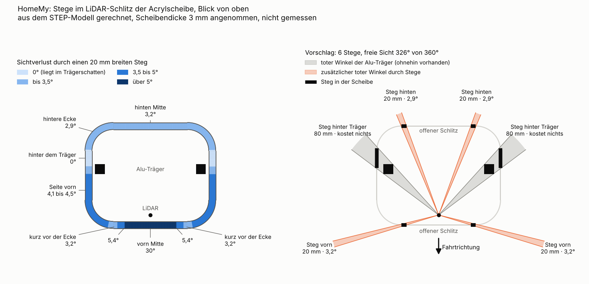

# LiDAR Looks Through an Open Slot With Six Support Webs

Status: accepted by the project owner; design values from CAD only. No slot has been measured with a live scan.
Date: 2026-11-16.

## Context

The STL-27L sits inside the HomeMy base, at the front, and scans through the band between the lower housing and the upper frame. That band was planned as a closed ring of infrared-transmitting acrylic.

The project owner tested the acrylic sheet in front of the LiDAR at several tilt angles. The LiDAR could not see through it in any position. A closed window is therefore not usable with this material.

The acrylic ring also carries load between the lower housing and the upper frame. It cannot simply be removed, and support only behind the two aluminium struts is not sufficient.

The owner states that the laboratory and prototype environment contains no obstacles below the scan plane. The scan height below is chosen on that basis and is not a statement about a home environment.

## Decision

The acrylic ring stays as a structural part. A slot is milled into it at scan height, interrupted by six webs that remain as load paths. The webs are placed where they cost the least view.

### Geometry

Frame for all values: origin at the centre of the 500 x 400 mm base outline, X forward, Y left, millimetres. This is a design frame, not a commissioned `base_link`.

| Item | Value |
| --- | --- |
| Base outline | X -200 to +200, Y -250 to +250, corner radius 100 |
| LiDAR rotation axis | X +160, Y 0 (40 mm behind the front wall) |
| Scan plane | 163.8 mm above the floor |
| Slot | about 40 mm high, 144 to 184 mm above the floor |
| Aluminium struts, 40 x 40 | X -46.2 to -6.2; left Y +184.2 to +224.2; right Y -223.8 to -183.8 |
| Drive-wheel axis | about X +91 (the two CAD wheel models differ by 2 mm) |

| Web | Wall | Extent | Width |
| --- | --- | --- | --- |
| Front left | front wall, X +200 | Y +130 to +150 | 20 mm |
| Front right | front wall, X +200 | Y -150 to -130 | 20 mm |
| Side left | left wall, Y +250 | X -110 to -30 | 80 mm |
| Side right | right wall, Y -250 | X -110 to -30 | 80 mm |
| Rear left | rear wall, X -200 | Y +130 to +150 | 20 mm |
| Rear right | rear wall, X -200 | Y -150 to -130 | 20 mm |

The four narrow webs end where the corner radius begins. The two side webs lie completely inside the shadow of the struts and add no blind angle.

### Mask Reference

Bearings are measured at the LiDAR rotation axis, in the robot-aligned direction: 0 degrees is straight ahead, positive is counter-clockwise seen from above (towards the robot's left), range -180 to +180.

| Blind sector | Cause | From | To | Width | Occluder distance from LiDAR axis |
| --- | --- | ---: | ---: | ---: | --- |
| 1 | front web, left | +72.9 | +76.1 | 3.2 | 135 to 155 mm |
| 2 | strut and side web, left | +126.9 | +137.9 | 11.0 | 250 to 368 mm |
| 3 | rear web, left | +157.2 | +160.1 | 2.9 | 380 to 390 mm |
| 4 | rear web, right | -160.1 | -157.2 | 2.9 | 380 to 390 mm |
| 5 | strut and side web, right | -137.9 | -126.9 | 11.0 | 249 to 368 mm |
| 6 | front web, right | -76.1 | -72.9 | 3.2 | 135 to 155 mm |

Geometric total: 34.4 degrees blind, 325.6 degrees free. With an assumed margin of 1 degree per sector edge the usable view is about 314 degrees. The real margin is a commissioning result.

Rules for the software that will consume this table:

- These are bearings at the LiDAR axis. They are not `base_link` bearings and not the driver's native scan angles. The driver zero direction and rotation sense are fixed only by the coupled L3 measurement in the LiDAR commissioning contract.
- Every part of the robot that the scan plane can touch lies within 0.40 m of the LiDAR axis. A return closer than that is the robot itself.
- A masked sector carries no information. It must not be treated as free space.

The figure is drawn from above with the driving direction pointing down, so the robot's left is on the right. Labels are in German.

### Not Selected

- A closed acrylic window: rejected by the owner's test.
- Any web on the front wall within 100 mm of the centre line: a 20 mm web costs 5.4 degrees there and 30 degrees at the centre.
- Webs on the side walls ahead of the struts: 4.1 to 4.5 degrees each, in the direction needed at door frames.

## Evidence

- Owner bench test on 2026-11-16: no view through the acrylic sheet at any tested tilt angle. No numeric data was recorded.
- Geometry and bearings were computed from `hardware/cad/homemy.step` (V2, SHA-256 `46d2ce68e5f2d179f7abac3a7a173e5e476d11da2bdcd0452cb6fbc11e6db7c6`) by cutting the model at the scan plane. Without webs, only the two struts intersect the plane.
- The strut sectors use the true profile cross-section. The web sectors assume a 3 mm sheet; a 5 mm sheet widens each front sector by about 0.7 degrees and each rear sector by about 0.1 degrees.
- The webs are not part of the CAD model. Their positions are the values in this record.

## Impact

- `contracts/hardware/lidar-commissioning.md`: these sectors are the expected starting point for stage L4.
- Navigation and obstacle protection: six known blind sectors must appear in the documented blind zones. No other planned sensor is assigned to cover them.
- SLAM and exploration: struts and webs produce close returns and must be masked before scans are used.

## Validation

None on hardware. The record contains CAD-derived predictions only. Acceptance requires L3 (direction and frame) and L4 (live-scan confirmation of every sector and its margin).

## Risks and Rollback

Risks: manufacturing tolerance of the milled webs, a different sheet thickness, LiDAR mounting offset or tilt, mixed returns at web edges, dust and objects entering the open slot, and stress cracks at milled corners that are not rounded.

The side webs are specified as X -110 to -30 so that they stay inside the strut shadow with a small margin. The earlier working figure of 90 mm (X -116 to -26) would exceed the shadow by about 0.3 degrees at each end.

Rollback: if the built slot differs, replace the tables in this record with measured values and repeat L4. A missing or unverified mask keeps every LiDAR-dependent function from declaring itself ready.
